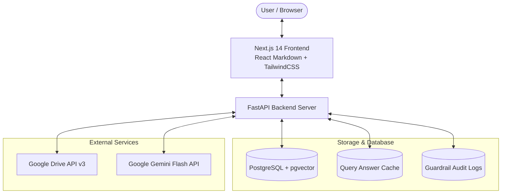
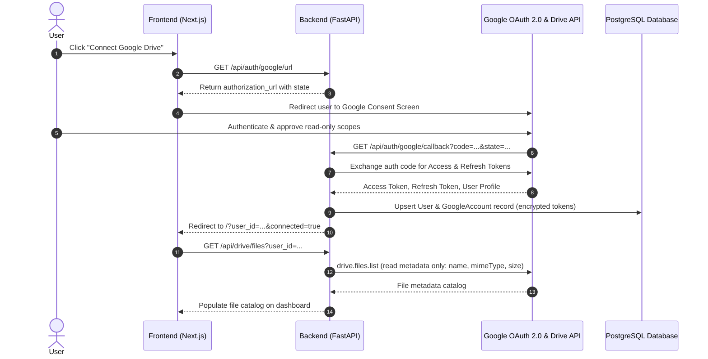

# AI-Drive Analyzer

AI-Drive Analyzer is a privacy-first, retrieval-augmented generation (RAG) platform that enables users to query, analyze, and extract insights from documents in their Google Drive using modern conversational AI.

---

## Table of Contents

1. [System Architecture Overview](#system-architecture-overview)
2. [User Flow](#user-flow)
3. [How Google Drive Connects to the System](#how-google-drive-connects-to-the-system)
4. [Query Submission & Processing Flow](#query-submission--processing-flow)
   - [Phase 1: Intent Classification & Answer Cache Check](#phase-1-intent-classification--answer-cache-check)
   - [Phase 2: Technical File Analysis & RAG Pipeline](#phase-2-technical-file-analysis--rag-pipeline)
5. [Answer Cache System & Performance](#answer-cache-system--performance)
6. [Privacy Guardrails & Confidentiality Engine](#privacy-guardrails--confidentiality-engine)
7. [Response Formatting & Frontend Rendering](#response-formatting--frontend-rendering)

---

## System Architecture Overview



---

## User Flow

The end-to-end journey for a user interacting with the platform:

1. **Connect Google Drive:**
   - On the web dashboard, the user clicks **Connect Google Drive**.
   - The user is redirected to Google's official OAuth 2.0 consent screen.
   - The user reviews and grants permissions (**read-only** Drive access).
   - Upon granting consent, Google redirects the user back to the application dashboard with an established session.
   - The dashboard dynamically displays the connected email address, connection status, and Google Drive file catalog.

2. **Explore the Document Catalog:**
   - The catalog organizes Drive files into category tabs: **All Files**, **Docs**, **Sheets**, and **PDFs**, accompanied by live search.
   - **Selective Querying:** The user can select one or more checkboxes to target specific files (e.g., an exact spreadsheet or policy document).
   - **AI Auto-Discovery:** If the user leaves the file selection empty, the system automatically analyzes the query and selects the most relevant files across the entire Drive catalog.

3. **Submit a Question in the Chat:**
   - The user enters a question into the conversational interface and clicks **Send** (or presses `Enter`).
   - The frontend immediately displays a multi-stage visual pipeline tracker indicating the current phase:
     1. `Finding Relevant Files`
     2. `Privacy & Security Check`
     3. `Reading Content`
     4. `Synthesizing Answer`
   - A **Cancel** button is provided allowing the user to abort in-flight requests at any time.

4. **Instant Cache Delivery vs. Live Analysis:**
   - **Cache Hit:** If an identical question (within the same file scope and user context) was recently asked, the system returns the verified answer **instantaneously (in milliseconds)** without re-reading or analyzing any files.
   - **Live Analysis:** If the answer is not cached, the backend executes the deep RAG analysis pipeline.

5. **Review the Formatted Answer:**
   - The assistant outputs clear, descriptive, and structured answers formatted in modern Markdown:
     - Clear section headers (`###`)
     - Key terms emphasized with selective **bolding**
     - Structured bullet points and numbered procedures
     - Side-by-side comparisons formatted in Markdown tables
     - Code snippets and database queries with syntax highlighting and a one-click **Copy** button
   - An **Identified Document(s)** tag lists the source files analyzed.
   - **Confidentiality notices** clearly explain if any sensitive files (e.g. salary slips, CNIC documents) were withheld.

6. **Manage Connection & Security:**
   - **Security Audit:** Users can open the Security Audit modal to review all guardrail events, timestamps, and detection reasons.
   - **Sync:** Refresh the Drive catalog to detect newly uploaded or renamed files.
   - **Disconnect Google Drive:** Revoke access and purge active credentials and answer cache entries with a single click.

---

## How Google Drive Connects to the System

Google Drive integration operates strictly under a **least-privilege, read-only** model using Google OAuth 2.0:



### Technical Connection Details:
- **OAuth Scopes Requested:**
  - `https://www.googleapis.com/auth/drive.readonly` (read-only document access; cannot create, modify, or delete files)
  - `https://www.googleapis.com/auth/userinfo.email` & `userinfo.profile` (identify the user)
  - `openid` (secure OpenID Connect authentication)
- **Token Management:**
  - Tokens are stored in the `google_accounts` table linked to the user's UUID.
  - Access tokens are automatically refreshed in the background using Google credentials refresh handlers when expired.
- **Non-Invasive Metadata Sync:**
  - Connecting Google Drive **does not download all files upfront**. It only fetches file metadata (ID, name, mime type, size, modified date). Document contents are downloaded and processed strictly **on-demand** when a relevant user query is submitted.
- **Disconnection Flow (`DELETE /api/auth/disconnect`):**
  - Revokes and deletes stored Google OAuth tokens from the database.
  - Automatically invalidates all cached query responses in `query_answer_cache` for that user.

---

## Query Submission & Processing Flow

When a user submits a query, the application executes a high-performance **two-phase architecture**:

```mermaid
flowchart TD
    Start([User Submits Query]) --> IntentCall["POST /api/rag/intent"]
    
    subgraph Phase 1: Intent & Cache Verification
        IntentCall --> ClassifyIntent["Classify Query Intent<br/>(direct_answer, summary, calculation, etc.)"]
        ClassifyIntent --> CheckCache{"Answer in Cache?<br/>(lookup_cached_answer)"}
        
        CheckCache -- "YES (Cache HIT)" --> InstantReturn["Return Cached Response<br/>⚡ Response in < 50ms<br/>(ZERO file download, ZERO embeddings, ZERO LLM calls)"]
        CheckCache -- "NO (Cache MISS)" --> RouteCandidates["Route Candidate Files<br/>(Title Match or Selection)"]
    end
    
    InstantReturn --> FrontendRender["Render in Frontend Chat<br/>(MarkdownRenderer.js)"]
    
    RouteCandidates --> AskCall["POST /api/rag/ask"]
    
    subgraph Phase 2: Technical RAG Pipeline (LangGraph)
        AskCall --> Node1["1. node_analyze_query<br/>(Auto-discovery via Gemini / User Selection)"]
        Node1 --> Node2["2. node_screen_guardrails<br/>(Screen CNICs, Passports, Salary Slips, Receipts)"]
        Node2 --> Node3["3. node_embed_content<br/>(On-demand Download & Text Extraction:<br/>pypdf + fontTools, openpyxl, python-docx)"]
        Node3 --> Node4["4. node_retrieve_chunks<br/>(all-MiniLM-L6-v2 Embeddings + Cosine Similarity)"]
        Node4 --> Node5["5. node_synthesize_answer<br/>(Google Gemini Flash + Exhaustive Reading Prompt)"]
        Node5 --> Node6["6. sanitize_confidential_output<br/>(Post-process Regex: Redact PSIDs, Phone #s, CNICs)"]
        Node6 --> StoreCache["Store Result in Cache<br/>(query_answer_cache table)"]
    end
    
    StoreCache --> FrontendRender
```

---

### Phase 1: Intent Classification & Answer Cache Check

Before downloading any document or calling large language models, the frontend calls `/api/rag/intent`:

1. **Deterministic Cache Key Generation:**
   - A unique cache lookup key is derived using:
     - `user_id` (ensures strict multi-tenant privacy isolation)
     - `query_hash` (SHA-256 of lowercase, stripped query text)
     - `intent` (classified query purpose)
     - `scope_hash` (hash of targeted file IDs)
2. **Answer Cache Lookup (`lookup_cached_answer`):**
   - **Cache HIT:**
     - The stored answer, citation metadata, and confidence details are verified against file modification versions.
     - The response is returned immediately to the frontend.
     - **No files are downloaded from Drive.**
     - **No text chunking or embedding models are executed.**
     - **No Gemini LLM tokens are consumed.**
     - Total turnaround time is typically under **50ms**.
   - **Cache MISS:**
     - The system performs lightweight filename matching against the cached Drive catalog.
     - Returns `analysis_required: true` and proceeds to Phase 2.

---

### Phase 2: Technical File Analysis & RAG Pipeline

When an answer is not cached, the compiled **LangGraph state machine (`rag_graph`)** executes the following sequential nodes:

#### Step 1: Candidate File Routing (`node_analyze_query`)
- **Explicit Selection:** If the user checked specific files in the UI, only those file IDs are used.
- **Filename-First Routing:** With a warm Drive catalog, strong filename matches (score ≥55) bypass the general-vs-Drive LLM classifier; ambiguous or weak matches retain the existing fallback.
- **AI Auto-Discovery:** If no files were selected, Gemini Flash analyzes the question against the user's Drive file catalog (names, MIME types, folder structure); at most 3 candidate files proceed to content checks.
- **Lazy Folder Lookup:** Query handling reads a shallow file catalog first and expands only folders selected as candidates; it does not crawl every folder before candidate selection.
- **Media Filter:** Queries asking about images or videos are intercepted early with a redirect response (`Please ask query about textual files`).

#### Step 2: Privacy & Guardrail Screening (`node_screen_guardrails`)
- Evaluates document titles and initial signatures against privacy rules.
- Files containing highly sensitive personal/financial records (e.g., CNIC scans, passport photos, salary slips, bank statements) are classified as **CONFIDENTIAL** and blocked.
- Blocked files are excluded from processing and logged into `guardrail_logs`.

#### Step 3: On-Demand Extraction & Chunking (`node_embed_content`)
- Safe candidate files are streamed on-demand from Google Drive.
- Only the safe candidate files for the current query are extracted and embedded; the pipeline does not pre-embed the whole Drive.
- Multi-format text extraction:
  - **PDF Documents:** Extracted using `pypdf`, backed by `fontTools` to parse embedded CFF Type1 fonts and non-standard character encodings.
  - **Excel Spreadsheets (`.xlsx`, `.xls`):** Parsed via `openpyxl`. If the user asked about a specific worksheet (e.g., `"Sales Data"`), the parser extracts only that worksheet.
  - **Word Documents (`.docx`):** Extracted via `python-docx` table and paragraph iterators.
  - **Plain Text / CSV:** Streamed and decoded directly.
- **Sliding-Window Chunking (`chunk_text`):** Extracted text is split into chunks (e.g., 500 characters with 100-character overlap) to preserve contextual boundaries.

#### Step 4: Semantic Embedding & Retrieval (`node_retrieve_chunks`)
- Text chunks are transformed into 384-dimensional dense vector embeddings using `SentenceTransformer('all-MiniLM-L6-v2')`.
- The user's query is embedded into the same semantic vector space (`embed_single_query`).
- Cosine similarity ranking identifies the top-scoring chunks (bounded to prevent oversized prompts and latency).

#### Step 5: Grounded Answer Synthesis (`node_synthesize_answer`)
- The retrieved chunks are assembled into a grounded context prompt for **Google Gemini Flash**.
- **Model Fallback Chain:** If the primary model encounters a transient error, the service automatically fails over across stable models (`gemini-3.5-flash-lite`, `gemini-3.5-flash`, `gemini-flash-lite-latest`) without crashing.
- **Prompt Guardrails Enforce:**
  - Strict groundedness: Answer only using supplied document evidence.
  - Zero hallucination: Refuse to fabricate missing data.
  - Clean Markdown formatting: Use proper headers (`###`), lists, tables, and bold highlights; never enclose full lines in double asterisks.

#### Step 6: Post-Processing & Confidentiality Redaction (`sanitize_confidential_output`)
- The generated response is passed through a regex safety sanitizer:
  - Redacts Transaction IDs, PSIDs (Payment Slip IDs), 1Bill consumer numbers.
  - Redacts Pakistani mobile numbers (`03xx-xxxxxxx`, `+92...`) and international phone numbers.
  - Redacts CNIC numbers (`xxxxx-xxxxxxx-x`).
  - Replaces sensitive requests with formal confidentiality notices.

#### Step 7: Cache Persistence (`store_cached_answer`)
- The verified, sanitized answer and its document version signatures are stored in `query_answer_cache` for instant future retrieval.

---

## Answer Cache System & Performance

The backend maintains a user-scoped PostgreSQL answer cache (`query_answer_cache` table) with configurable Time-To-Live (TTL) values:

| Answer Kind | Default TTL | Description |
|:---|:---|:---|
| **Drive Grounded Answers** | 60 seconds (`QUERY_ANSWER_CACHE_TTL_SECONDS`) | Answers grounded in Google Drive files; short TTL ensures updates in Drive are quickly reflected. |
| **General Knowledge Answers** | 24 hours (`GENERAL_ANSWER_CACHE_TTL_SECONDS`) | Answers to general questions unassociated with specific documents. |
| **Insufficient Evidence Answers** | 30 seconds (`INSUFFICIENT_ANSWER_CACHE_TTL_SECONDS`) | Brief cache when no evidence was found, allowing quick re-tests after Drive updates. |
| **User Confirmation Decisions** | 1 hour (`QUERY_DECISION_CACHE_TTL_SECONDS`) | User choices for general-knowledge confirmation dialogs. |

- **Cache Invalidation:** Disconnecting Google Drive instantly flushes all cache entries for that user.
- **Concurrency Coalescing:** Simultaneous duplicate query misses are coalesced into a single execution to avoid redundant API and LLM calls.

---

## Privacy Guardrails & Confidentiality Engine

The platform implements multi-tiered security to protect sensitive user data:

1. **Metadata Screening:** Checks file names for sensitive tags before extraction.
2. **Exclusion of High-Risk Files:** Files identified as salary slips, tax returns, bank statements, or national identity documents are skipped.
3. **Regex Sanitization Post-Filter:** Enforces that no private identifiers (phone numbers, CNICs, transaction IDs) leave the backend.
4. **Audit Logging:** Every guardrail decision, detection type, and confidence score is recorded in `guardrail_logs` and viewable via the **Security Audit** modal.

---

## Response Formatting & Frontend Rendering

The chat UI provides clean, modern formatting powered by `MarkdownRenderer.js`:

- **Component Engine:** Built on `react-markdown` (v10) and `remark-gfm`.
- **Headers & Structure:** Custom semantic tags (`<h1>` to `<h4>`) with tailored typography.
- **Tables:** Responsive tables with borders and header highlights.
- **Code Blocks:** Fenced code blocks with language indicators, monospaced font, and a one-click copy button.
- **Inline Elements:** Selective bolding, italicized notes, inline `code` badges, and external links opening securely in new tabs.
- **Source Badges:** Displays document sources and verification tags above the response text.
